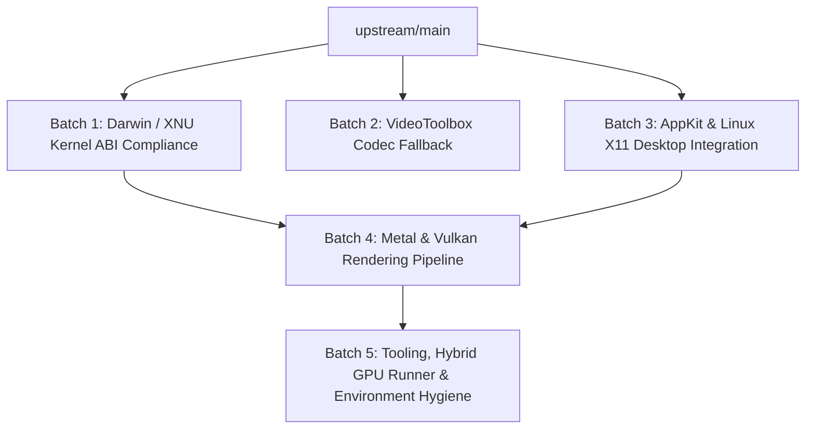

# Upstream Pull Request Batching Plan (`darling-lol`)

This document defines the strategy for decomposing the commits ahead of `origin/main` into cohesive, modular, and cleanly reviewable Pull Requests for the upstream repository ([`lucannez64/darling-lol`](https://github.com/lucannez64/darling-lol)).

---

## 1. Governance & Golden Rules

1. **Strict Terminology & Architectural Neutrality**: NEVER mention third-party integrity or anti-tamper system names or acronyms in any branch name, commit message, code comment, or pull request description. All changes must be framed strictly as official Apple Darwin, XNU, POSIX, FreeDesktop, or Vulkan/Metal ABI compliance.
2. **Subsystem Isolation**: Avoid monolithic pull requests. Each batch must address a single functional subsystem so upstream maintainers can review, test, and merge incrementally without risking cross-subsystem regressions.
3. **Patch Integrity Verification**: Each PR branch must pass `python3 scripts/prepare.py --check-only` independently.

---

## 2. Dependency Graph (DAG)



---

## 3. Batch Breakdown

### Batch 1: Darwin / XNU Kernel ABI Compliance
- **Target Subsystems:** `xnu`, `security`
- **Suggested Branch:** `upstream-sync/xnu-darwin-abi-compliance`
- **Affected Patches:** `patches/xnu.patch`, `patches/security.patch`
- **Included Commits:**
  - `fd3600d`: `feat(xnu): integrate truthful security APIs and CPUID validation from PR #48`
  - `3878164`: `feat(xnu): implement PROC_PIDLISTFDS, realistic csops status flags and hw.packages sysctl for Darwin compliance`
  - `8c18d78`: `fix(xnu): pass --disable-accelerated-video-decode to LeagueClientUx`
  - `455aa48`: `chore(security): sanitize Apple references to neutral Darwin platform terms`
- **Scope & Rationale:**
  - Implements `_proc_pidinfo` with flavor `PROC_PIDLISTFDS` (file descriptor enumeration).
  - Supplies realistic code signing flags in `csops` (`CS_VALID | CS_HARD | CS_KILL | CS_RESTRICT | CS_RUNTIME`).
  - Implements sysctl `hw.packages` returning the number of physical CPU sockets (`1`).
  - Returns truthful Darwin security API answers.

---

### Batch 2: VideoToolbox Decompression Graceful Fallback
- **Target Subsystems:** `VideoToolbox`
- **Suggested Branch:** `upstream-sync/videotoolbox-graceful-fallback`
- **Affected Patches:** `patches/darling.patch` (`src/frameworks/VideoToolbox/`)
- **Included Commits:**
  - `854556c`: `fix(videotoolbox): return kVTVideoDecoderNotAvailableErr from decompression session stubs`
- **Scope & Rationale:**
  - Returns `kVTVideoDecoderNotAvailableErr` from decompression session creation stubs instead of asserting or fabricating an unbacked session.
  - Allows Chromium CEF / Electron to detect hardware acceleration absence cleanly and fall back to software VP8/VP9/AV1 decoding without UI freezes.

---

### Batch 3: AppKit & Linux X11 Desktop Integration
- **Target Subsystems:** `cocotron` (`AppKit`)
- **Suggested Branch:** `upstream-sync/appkit-x11-desktop-integration`
- **Affected Patches:** `patches/cocotron.patch` (`AppKit/`)
- **Included Commits:**
  - `5c7dd4b`: `feat(cocotron): support borderless window decorations for full size content views`
  - `d322b7d`: `feat(cocotron): implement Linux X11 FreeDesktop system tray support and NSStatusBarButton`
  - `9ec6fa3`: `fix(cocotron): do not raise fatal exception on window GL context creation failure`
  - `fbcf963`: `fix(cocotron): consolidate CALayer dealloc cleanup`
  - `98ad7f1`: `feat(cocotron): broaden CSD drag coordinates and improve FreeDesktop tray docking`
  - `900c41b`: `fix(cocotron): restrict X11 CSD drag to titlebar strip without isMovableByWindowBackground`
- **Scope & Rationale:**
  - Supports `NSFullSizeContentViewWindowMask` and strips duplicate native Linux titlebars via `_MOTIF_WM_HINTS` for client-side decorated windows.
  - Implements FreeDesktop XEmbed system tray docking (`NSStatusBar` and `NSStatusItem`).
  - Provides smooth window dragging for borderless/CSD windows via `_NET_WM_MOVERESIZE` and `performWindowDragWithEvent:`.
  - Scopes CSD window dragging exclusively to the titlebar strip and removes `isMovableByWindowBackground` interception on full window bodies so buttons, inputs, and tabs receive normal mouse clicks.

---

### Batch 4: Metal & Vulkan Rendering Pipeline
- **Target Subsystems:** `metal`, `indium`, `QuartzCore`, `OpenGL`
- **Suggested Branch:** `upstream-sync/metal-vulkan-presentation-pipeline`
- **Affected Patches:** `patches/metal.patch`, `patches/metal--deps--indium.patch`, `patches/cocotron.patch` (`QuartzCore/`), `patches/darling.patch` (`OpenGL/`)
- **Included Commits:**
  - `c35c3e9`: `indium: prioritize discrete GPU over integrated GPU in default device selection`
  - `09455b8`: `metal: sanitize fallback MTLDevice name to Generic Display Adapter`
  - `b900de4`: `fix(graphics): respect /tmp/metal-gpu in CGL and support CALayer backgroundColor rendering`
  - `de661c9`: `QuartzCore: resolve CAMetalLayer drawable timeout and starvation`
  - `e8dd652`: `OpenGL: close failed X11 connections in CGLCreateContext display recovery`
  - `334d1a5`: `fix(cocotron): resolve native display and swapchain target in CAMetalLayer`
  - `84170b3`: `perf(cocotron): eliminate synchronous CPU fence wait and add multi-flight presentation`
- **Scope & Rationale:**
  - Prioritizes discrete GPU over integrated GPU in `Indium::initGlobalDeviceList`.
  - Sanitizes GPU fallback name to standard `"Generic Display Adapter"`.
  - Resolves drawable starvation in `CAMetalLayer` with reliable replenishment.
  - Closes failed X11 connections in `OpenGL.c` recovery to prevent file descriptor exhaustion.
  - Implements direct Vulkan presentation (`VkSurfaceKHR` + `VkSwapchainKHR`) eliminating cross-API GL/EGL interop bottlenecks.
  - Resolves native X11 display pointer with multi-tier fallbacks and implements subwindow/top-level presentation targets for Xwayland compositors.

---

### Batch 5: Tooling, Hybrid GPU Runner, Lifecycle Supervisor & Environment Hygiene
- **Target Subsystems:** `tools/`, `scripts/`
- **Suggested Branch:** `upstream-sync/runner-hybrid-gpu-and-env-hygiene`
- **Affected Files:** `tools/run-riot-client.sh`, `tools/riot-lifecycle-supervisor.py`, `tools/build-*.py`, `tools/install-*.py`
- **Included Commits:**
  - `ba58935`: `fix(runner): sanitize leaked DARLING environment variables to prevent detection`
  - `6f46367`: `fix(runner): align OpenGL and Vulkan GPU selection on hybrid laptops`
  - `7128ace`: `fix(runner): translate environment variable sanitization comment to English`
  - `847d489`: `refactor(cocotron): restore standard DARLING environment variable conventions`
  - `a181f06`: `fix(tools): force overwrite in atomic_install to prevent interactive prompt`
  - `d7dd724`: `tools: install rebuilt QuartzCore to both system and user framework paths`
  - `f57ee2d`: `tools: install rebuilt OpenGL to both system and user framework paths`
  - `7aea80a`: `chore(tools): remove legacy EGL environment variables from launcher`
  - `cf50bc6`: `feat(lifecycle): implement clean shutdown and match protection supervisor`
  - `0e36f85`: `fix(lifecycle): ignore lingering CEF helper processes when detecting client closure`
- **Scope & Rationale:**
  - Adds NVIDIA PRIME render offload configuration for hybrid graphics setups.
  - Sanitizes runtime environment to prevent host leaks.
  - Updates overlay build scripts to install frameworks into both system and runtime framework paths.
  - Introduces intelligent lifecycle supervisor (`tools/riot-lifecycle-supervisor.py`) ensuring clean shutdown of Darling services when client windows close while preserving runtime during matches and filtering auxiliary CEF helper processes.

---

## 4. Execution Workflow for the PR Agent

For each batch `N` (1 through 5):
1. **Branch Creation**:
   ```bash
   git checkout -b <branch-name> upstream/main
   ```
2. **Selective Cherry-Pick**:
   ```bash
   git cherry-pick <commit-hash-1> <commit-hash-2> ...
   ```
3. **Patch Integrity Verification**:
   ```bash
   python3 scripts/prepare.py --check-only
   python3 scripts/validate.py
   ```
4. **Pull Request Description Generation**:
   Produce a technical, upstream-ready Markdown PR description detailing:
   - Problem statement and root cause.
   - Proposed changes and affected subsystems.
   - Verification steps and passing validation outputs.
